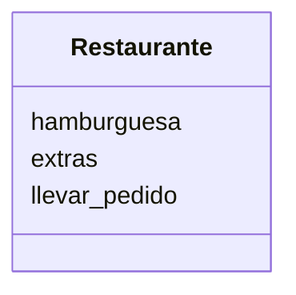

realiza el Análisis y el Diagrama de clases para el siguiente escenario

Un restaurante quiere ofrecer hamburguesas
Los clientes pueden elegir entre hamburguesa de: res, pollo
o vegetariana.
Los clientes pueden agregar extras como: lechuga, tomate, 
cebolla y mayonesa
Ademas los clientes pueden decidir comer en el restaurante 
o llevar su pedido

#Analisis

Requisitos:
- ofrecer hamburguesas
- cliente elige entre haburguesa de res, pollo o vegetariana.
- cliente puede agregar extras como lechuga, tomate, cebolla y mayonesa
- cliente decide llevar el pedido o comer en el restaurante

Objetos:
- Restaurante

Características:
- Restaurante:
    - hamburguesa res, pollo o vegetariana
    - extras (lechuga, tomate, cebolla, mayonesa)
    - llevar pedido

Acciones:
- (No hay acciones)

