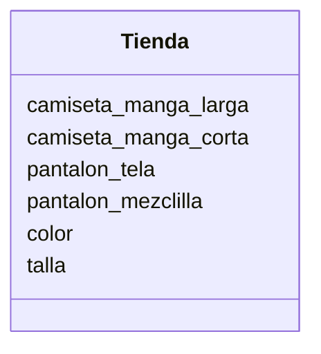

realiza el Análisis y el Diagrama de clases para lo siguiente el siguiente escenario

Una tienda de ropa quiere ofrecer camisetas y pantalones
Los clientes pueden elegir entre: camiseta
de manga corta o larga y pantalón de mezclilla o tela
Las camisetas pueden ser de color rojo, azul o verde
y los pantalones de color negro, gris o blanco
Las camisetas tienen las tallas: S, M, L, XL
Los pantalones tienen las tallas desde la 32 hasta la 44

#Analisis

Requisitos:
- ofrecer camisetas y pantalones
- cliente elige entre camiseta manga larga o corta
- cliente elige entre pantalon de mezclilla o tela
- color camiseta puede ser rojo, azul o verde
- color pantalon negro, gris o blanco
- talla camisetas S, M, L, XL
- talla pantalon desde 32 hasta 44

Objetos:
- Tienda

Características:
- Tienda:
    - camiseta_manga_larga
    - camiseta_manga_corta
    - pantalon_tela
    - pantalon_mezclilla
    - color
    - talla

Acciones:
- (No hay acciones)

