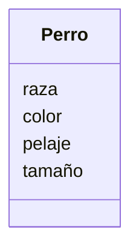

realiza el Análisis y el Diagrama de clases para lo siguiente el siguiente escenario

Estas diseñando una app para dibujar de perros con IA 
los usuarios pueden seleccionar características como 
la raza (por ejemplo, labrador o pastor alemán), el color 
del pelaje, el tamaño y el tipo de orejas.
Además, pueden agregar hasta dos accesorios, como sombreros 
o gafas.
El dibujo final puede descargarse en formato PNG o JPG.

#Analisis

Requisitos:
- raza
- color
- pelaje
- tamaño
- tipo de orejas
- 
Objetos:
- Perro

Características:
- Perro:
    - raza
    - color
    - pelaje
    - tamaño
    - tipo de orejas

Acciones:
- (No hay acciones)

