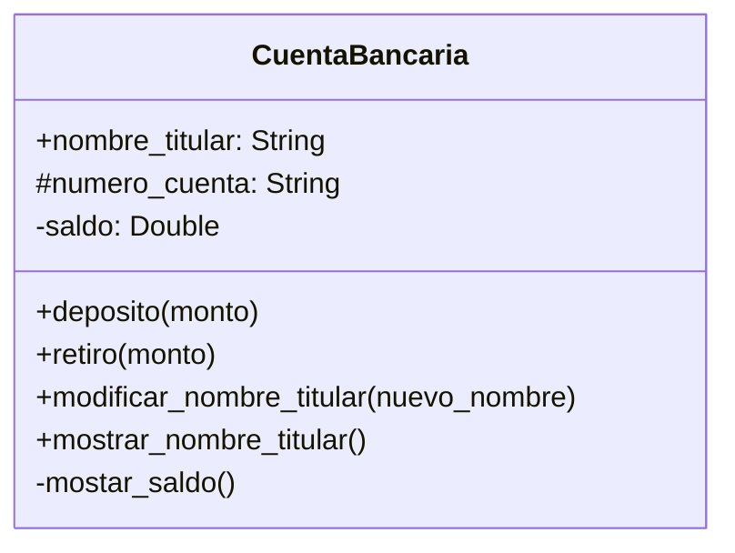

Un banco necesita desarrollar un módulo para gestionar cuentas bancarias. Cada cuenta tiene las siguientes caracteristicas:
 
saldo: Es un dato privado. Solo puede consultar. Se puede modificar únicamente a través de deposito y retiro
deposito: Permite ingresar dinero, incrementando el saldo.
retiro: Permite retirar dinero, siempre y cuando el saldo disponible sea suficiente

número de cuenta: Es privado. Puede consultarse, pero no puede modificarse una vez asignado.
nombre del titular: Es público. Puede consultarse y modificarse libremente.

Realiza el análisis y diagrama de clases de la clase Cuenta en el archivo ejercicio_01.md.
Escribe el codigo en Python para la clase Cuenta en el archivo ejercicio_01.py.
Implementa encapsulamiento para proteger los atributos sensibles
Utiliza getters y setters para controlar el acceso y la modificación de los atributos.
Propiedades para ofrecer una interfaz clara y segura al usuario del sistema.

# Análisis
Requisitos:
- Tiene nombre del titular
- Tiene un numero de cuenta
- Tiene un saldo
- Existe un método consultar_saldo
- Existe un método deposito
- Existe un metodo retiro
- Saldo solo se puede modificar por retiro o deposito
- Saldo solo se puede consultar y es privado
- Deposito incrementa el saldo
- Retiro disminuye el saldo siempre y cuando el saldo sea suficiente
- Numero de cuenta solo se puede consultar, no se puede modificar y es privado
- Nombre del titular se puede consultar y modificar libremente
Objetos:
- CuentaBancaria
Características:
- CuentaBancaria:
    - nombre_titular: String
    - numero_cuenta: String
    - saldo: float
Acciones:
- CuentaBancaria:
    - deposito(monto)
    - retiro(monto)
    - mostrar_nombre_titular()
    - mostrar_saldo()
    - modificar_nombre_titular(nuevo_nombre)

    