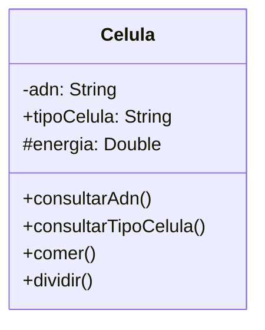

Un médico necesita simular el comportamiento de una célula. Cada célula debe cumplir con las siguientes características:
 
ADN: Se puede consultar pero no puede cambiar.
tipo de célula: Puede consultarse y modificarse libremente.
energía: Es un dato privado. Puede aumentar o disminuir, únicamente mediante las acciones de comer o dividirse.

Realiza el análisis y el diagrama de clases de la clase Celula en el archivo ejercicio_02.md.
Escribe el código en Python para la clase Celula en el archivo ejercicio_02.py.
Implementa encapsulamiento para proteger los atributos sensibles.
Utiliza getters y setters para controlar el acceso y la modificación de los atributos.
Aplica propiedades para ofrecer una interfaz clara y segura al usuario del sistema.

# Análisis
Requisitos:
- Tiene ADN
- Tiene tipo de celula
- Tiene energia
- Existe un método consultar_adn
- Existe un método para consultar_tipo_celula
- Energia solo se puede modificar por comer o dividirse
- Tipo de celula se puede consultar y modificar libremente
- ADN no se puede cambiar
Objetos:
- Celula
Características:
- Celula:
    - adn: String
    - tipoCelula: String
    - energia: Int
Acciones:
- Celula:
    - consultarAdn()
    - consultarTipoCelula()
    - comer()
    - dividir()
