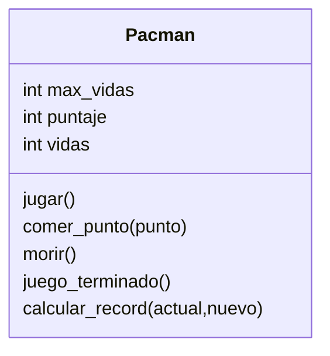

# Análisis
Requisitos:
- Crear un pacman
- Pacman tiene un puntaje
- Pacman tiene vidas
- Pacman inicia con máximo 2 vidas
- Pacman puede comerse los puntos
- Pacman suma el valor de los puntos
- Pacman pierde una vida cuando muere
- Pacman termina el juego cuando se queda sin vidas
- Pacman calcula si hay un nuevo record
Objetos:
- Pacman
Características:
- Pacman: `max_vidas`, `vidas`, `puntaje`
Acciones:
- Pacman:   `jugar`, `comer_punto`, `morir`,
            `juego_terminado`, `calcular_record`

