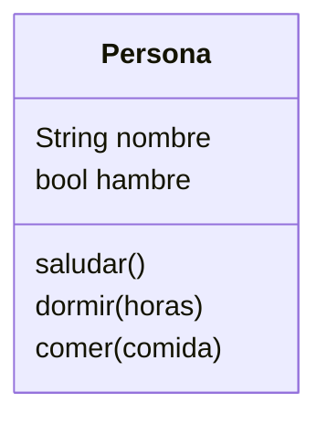

# Análisis

Requisitos:
- Crear personas
- Las personas tienen un nombre
- Las personas pueden saludar
- Las personas pueden dormir
- Las personas pueden comer
- Al despertar tienen hambrenombre
  
Objetos:
- Persona
  
Características:
- Persona: Nombre, cansancio, hambre
  
Acciones:
- Persona: Saludar, cansancio, comer
