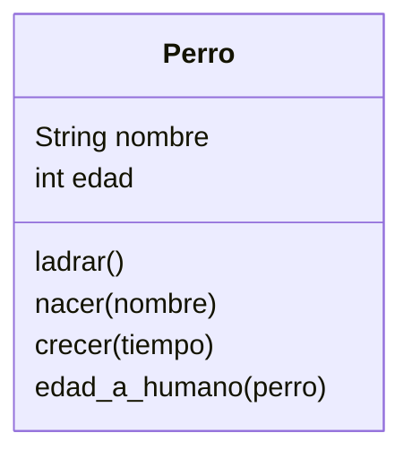
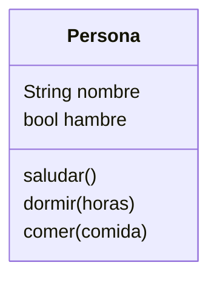

# Análisis
Requisitos:
- Crear un perro
- Los perros tienen un nombre
- Los perros pueden ladrar
- Los perros nacen como cachorros
- La edad de un perro es 7 veces menor que la de un humano
Objetos:
- Perro
Características:
- Perro: nombre, edad
Acciones:
- Perro: ladrar, nacer, crecer, edad_a_humano

# Análisis

Requisitos:
- Crear personas
- Las personas tienen un nombre
- Las personas pueden saludar
- Las personas pueden dormir
- Las personas pueden comer
- Al despertar tienen hambrenombre
  
Objetos:
- Persona
  
Características:
- Persona: Nombre, cansancio, hambre
  
Acciones:
- Persona: Saludar, cansancio, comer
