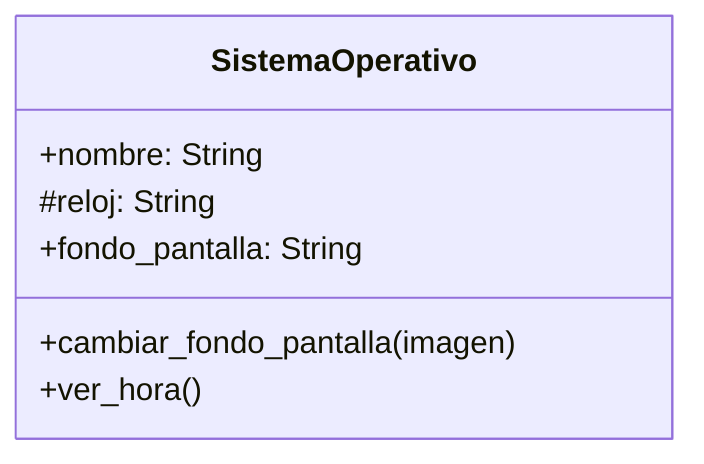

Un pequeño equipo de desarrolladores decidió crear
un sistema operativo para un celular,
inicialmente sólo tendrá un fondo de pantalla
Todos podemos ver y cambiar el fondo de pantalla,
el SO se llamará `PyPhoneOS`
tendrá un fondo inicial de `gatitos.jpg`

# Análisis
Requisitos:
- Tiene un nombre
- Tiene un fondo de pantalla
- Cualquiera puede cambiar el fondo de pantalla
- Tiene un reloj
- Existe un método ver hora 
  
Objetos:
- SistemaOperativo
  
Características:
- SistemaOperativo:
    - nombre: String
    - fondo_pantalla: String
    - reloj: String

Acciones:
- SistemaOperativo:
    - cambiar_fondo_pantalla(imagen)
    - ver_hora()
